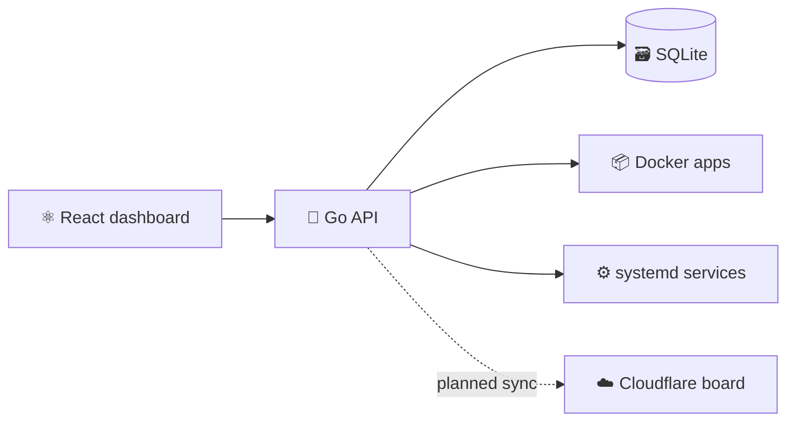

<h1 align="center">🗼 Lighthouse</h1>

<p align="center"><strong>A focused control plane for self-hosted applications.</strong></p>

<p align="center">
  
  
  
  
</p>

Lighthouse monitors Docker and systemd applications from their internal or external addresses, with a local dashboard and an independent Cloudflare recovery board.

> 🚧 **Early MVP** — monitoring and the local API are implemented; authentication, host actions, and cloud synchronization are planned.



## ✨ Included

- Application registration and reachability status
- Internal and external HTTP(S) checks
- SQLite persistence, OpenAPI contract, and Swagger UI
- Responsive local dashboard and static recovery board

## 🚀 Run locally

```bash
# terminal 1
cd main/backend && go run ./cmd/lighthouse

# terminal 2
cd main/frontend && npm install && npm run dev
```

Open **http://localhost:5173** · API docs: **http://localhost:8080/docs/**

## 🧭 Explore

[Architecture](docs/ARCHITECTURE.md) · [Build plan](docs/BUILD_PLAN.md) · [Verification](docs/VERIFICATION.md)
